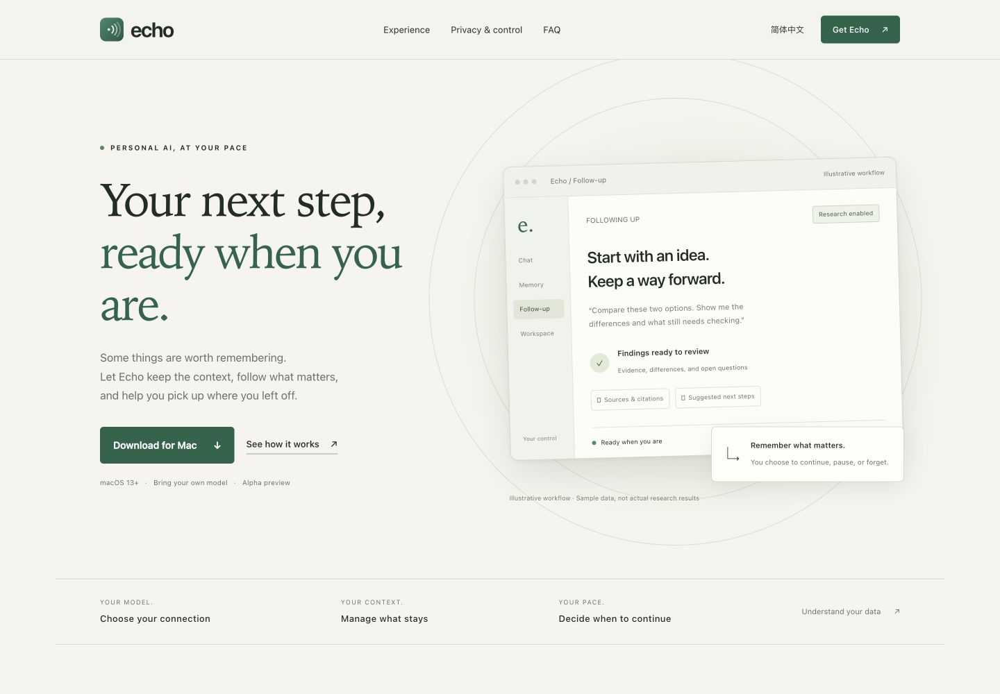

# Echo

### Keep the thread. Move things forward.

A personal AI assistant for your Mac, with memory you can manage, 
research you choose to enable, and tools for the work in front of you.

**macOS · Bring your own model · Alpha**

[Download](https://github.com/Lazarus-coder/echo-assistant/releases/tag/v0.1.0-alpha.6) · [Explore Echo](site/) · [中文](README.zh-CN.md)

---

Echo brings conversations, personal context, and ongoing goals into one place. Start with a question, keep what matters, and return to a clear next step. Choose your own compatible model endpoint and API key; Echo runs on your Mac and stores its records there.

## Made for work that continues

| When you want to… | Echo helps you… |
|---|---|
| **Work through a question** | Discuss ideas, refine a prompt, search for sources, and revisit a conversation. Image input and generation are available when supported by your selected models. |
| **Prepare for a goal** | Define the outcome and next step. With background research enabled, use public sources, attached documents, and selected folders to prepare findings and follow relevant dates or source changes. |
| **Work on a project** | Connect a local workspace to read files and, with the relevant permissions enabled, edit them or run commands. Follow the current step and outcome, then return to saved steps and outputs. |

## Context that stays useful

**Memory you can manage.** Inspect, protect, revive, or remove remembered facts. Choose a memory level and adjust response preferences. Older, unused facts can fade; you decide what should remain.

**Follow-up on your terms.** Background research starts off. Turn it on in **主动服务**, then choose each goal's sources. Research and notifications have separate controls, with quiet hours and delivery limits. You can review a result, correct it, pause a goal, or mark it complete.

**Optional screen context.** Screen awareness and companion mode start off. If you enable them and grant macOS Screen Recording permission, Echo can use recent screen context and offer brief suggestions. Selecting the deep memory profile also enables screen awareness. Capture can be paused from the menu bar.

## Know what you are sharing

| Control | What it means |
|---|---|
| **Your model connection** | Conversations and any memory, document extracts, images, or tool results used for a response are sent to the endpoint you configure. Model capabilities, data handling, and charges depend on that provider. |
| **Your records** | Conversations, memory, goals, and execution records are stored on your Mac. Export and deletion controls are available. Local storage does not make model requests offline or retract data already sent to a provider. |
| **Your research scope** | Background research uses read-only tools and the sources you allow. Search queries go to the configured search provider. It cannot run Shell commands, call MCP tools, edit files, or contact other people. |
| **Your workspace permissions** | Workspace tools start off; reading, editing, and Shell have separate controls. Shell and MCP calls require approval. Shell runs with your account's privileges; it is not an operating-system sandbox. |

Screen capture uses on-device OCR by default; extracted text can be sent to your model. Image mode can send screenshots. Local workspace execution and approvals are available only on the host Mac.

Echo can also expose chat to your local network, with no password by default. Enable password protection or restrict access to this Mac before using it on a shared network. See the [permissions and data guide](docs/permissions.md) for the full controls.

## Start with Echo

1. **Download for macOS.** Choose a macOS package from [v0.1.0-alpha.6](https://github.com/Lazarus-coder/echo-assistant/releases/tag/v0.1.0-alpha.6). The current installer targets macOS 13+ on Apple Silicon or Intel and requires Node.js 22.13 or newer.
2. **Connect your model.** Run **Install Echo.command**, then use the setup wizard to enter a compatible endpoint, API key, and model. The installer adds a menu-bar app and a service that starts at login.
3. **Choose what to enable.** Start a conversation, select a memory level, and enable background research, screen context, or workspace access when useful.

Model and search usage may incur charges from your chosen providers. Read the [getting-started guide](docs/getting-started.md) for installation, access controls, and removal; see the [developer guide](docs/development.md) for source setup.

## An early product, with clear limits

Echo is in **alpha**. Interfaces and data formats may change; back up your data before upgrading. Research results need your review, and checks run only while your Mac is awake and Echo is running. There is no automatic browser, email, or calendar ingestion. Scanned PDFs without extractable text are reported as unreadable.

This repository describes the current source. Published packages may lag behind it; check the notes for the version you download.

## Learn more

- [Product site files](site/) · [English page](site/en.html) · [Preview locally](docs/development.md#preview-the-product-site)
- [Getting started](docs/getting-started.md) · [Permissions and data](docs/permissions.md)
- [Development, tests, and source installation](docs/development.md)
- [Release history](CHANGELOG.md) · [Report an issue](https://github.com/Lazarus-coder/echo-assistant/issues)

No license file is currently included in this repository. Contact the maintainers about reuse.
